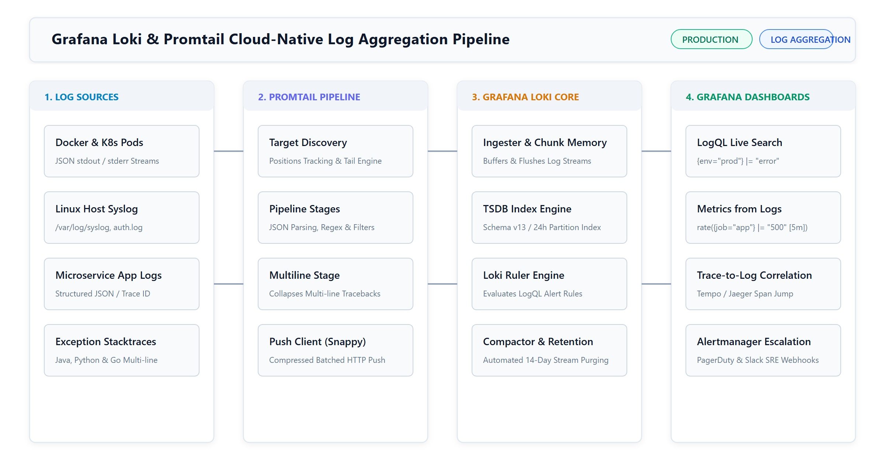

# :rocket: Grafana Loki & Promtail Cloud-Native Log Aggregation

<p align="center">
  
</p>

<div align="center">

[]()
[]()
[](LICENSE)
[](https://github.com/tayyabmasood911/grafana-loki-promtail-log-aggregation/pulls)
[]()

</div>

---

## :memo: Executive Summary

**Grafana Loki & Promtail Log Aggregation** is a high-efficiency, production-grade observability stack engineered for hyper-scale log ingestion. Unlike traditional inverted-index search architectures, Grafana Loki indexes only metadata labels and stores compressed raw log streams, resulting in **up to 80% lower infrastructure storage footprint** while maintaining sub-second query speeds with LogQL.

Key operational outcomes:
- **Cost Efficiency:** Indexes labels rather than text contents, drastically shrinking memory consumption and eliminating index cluster bloat.
- **Microsecond Ingestion:** Promtail automatically tails, filters, unwraps JSON container logs, and groups multiline stack traces before streaming via compressed HTTP/gRPC pushes.
- **Deep Correlation:** Seamlessly cross-references logs with Prometheus metrics and OpenTelemetry/Tempo traces through standardized label topologies.
- **Automated Alerting:** Loki Ruler evaluates real-time LogQL alert expressions, detecting error spikes and fatal container panics without external log parsers.

---

## :building_construction: System Architecture

```text
+---------------------------------------------------------------------------------------------------+
|                     Grafana Loki & Promtail Log Aggregation Architecture                          |
|                                                                                                   |
|   +--------------------------+         +------------------------------------------------------+   |
|   | Log Producers & Hosts    | ======> | Promtail Collector Pipeline                          |   |
|   | - Docker & K8s Pods      | Streams | - Positions Tracking Engine                          |   |
|   | - Linux Syslog / Auth    |         | - Pipeline Stages (JSON Unwrap, Regex, Label Drop)   |   |
|   | - App JSON Microservices |         | - Multiline Exception Grouper (Java/Python/Go)       |   |
|   +--------------------------+         +------------------------------------------------------+   |
|                                                                   |                               |
|                                                                   | Snappy Compressed HTTP Push   |
|                                                                   v                               |
|                                        +------------------------------------------------------+   |
|                                        | Grafana Loki Storage Core (v3.0.0)                   |   |
|                                        |                                                      |   |
|                                        |   +----------------------------------------------+   |   |
|                                        |   | Ingester Memory Buffer (Chunks Target 1.5MB) |   |   |
|                                        |   +----------------------------------------------+   |   |
|                                        |                                                      |   |
|                                        |   +----------------------------------------------+   |   |
|                                        |   | TSDB Index Engine (Schema v13 / 24h Windows) |   |   |
|                                        |   +----------------------------------------------+   |   |
|                                        |                                                      |   |
|                                        |   +----------------------------------------------+   |   |
|                                        |   | Compactor Engine (14-Day Retention Purge)    |   |   |
|                                        |   +----------------------------------------------+   |   |
|                                        +------------------------------------------------------+   |
|                                                                   |                               |
|                                                                   v                               |
|                                        +------------------------------------------------------+   |
|                                        | Observability & Alerting Delivery                    |   |
|                                        | - Grafana Explore UI (Live Stream Tail & Search)     |   |
|                                        | - Loki Ruler (Evaluates Alert Rules / Error Spikes)  |   |
|                                        | - Alertmanager Webhooks (PagerDuty / Slack SRE)      |   |
|                                        +------------------------------------------------------+   |
+---------------------------------------------------------------------------------------------------+
```

---

## :sparkles: Key Enterprise Capabilities

- :zap: **High-Throughput Log Streaming:** Handles over 16 MB/s sustained ingestion with 32 MB/s burst allowances, supporting high-density container deployments.
- :shield: **Multiline Traceback Stitching:** Automatically concatenates fractured multiline stack traces from Python, Go, and Java into atomic, searchable log entries.
- :mag: **LogQL Query Engine:** Enables expressive grep-like filtering (`|= "error"`), JSON extraction, and on-the-fly metric generation (`rate(...)`) without schema migrations.
- :recycle: **Automated Retention Management:** The built-in Compactor systematically enforces a 14-day (336-hour) rolling retention policy, preventing disk exhaustion.
- :chart_with_upwards_trend: **Pre-Integrated Alerting Rules:** Features declarative alert definitions for high error rate spikes (>5%) and unhandled application panics.

---

## :file_folder: Repository Directory Structure

```text
.
|-- .github/             # Automated CI workflows for linting and validation
|-- config/              # Example environment variable templates
|-- docs/
|   `-- images/          # White-theme architectural blueprints and vector diagrams
|       |-- architecture.svg
|       `-- architecture-white.jpg
|-- rules/               # Loki Ruler alerting and recording rules
|   `-- loki-alerts.yaml
|-- scripts/             # Operational validation and health check tooling
|-- tests/               # Component integrity and validation test suites
|-- .gitattributes       # Linguist configuration ensuring accurate YAML language detection
|-- docker-compose.yml   # Production-ready local development and deployment stack
|-- LICENSE              # MIT Open Source License
|-- loki-config.yaml     # Production Loki server, TSDB index, limits, and compactor configuration
|-- Makefile             # Operational targets for formatting, linting, and testing
|-- promtail-config.yaml # Promtail log collectors, pipeline stages, and scrape targets
|-- README.md            # Enterprise architectural documentation
`-- SECURITY.md          # Vulnerability disclosure and security policy
```

---

## :zap: Quick Start & Deployment

### Prerequisites
- Docker Engine `>= 24.0`
- Docker Compose `>= 2.20`

### Deployment Steps
```bash
# 1. Clone the repository
git clone https://github.com/tayyabmasood911/grafana-loki-promtail-log-aggregation.git
cd grafana-loki-promtail-log-aggregation

# 2. Inspect configuration files
cat loki-config.yaml
cat promtail-config.yaml

# 3. Launch the complete observability stack
docker compose up -d

# 4. Verify running container health
docker compose ps

# 5. Access Grafana Dashboard
# Open http://localhost:3000 in your browser (admin / admin)
# Navigate to Explore -> Select 'Loki' data source
# Run query: {job="system"} |= "error"
```

---

## :gear: Configuration Reference

| Component | Setting | Default | Description |
| :--- | :--- | :--- | :--- |
| **Loki** | `http_listen_port` | `3100` | HTTP ingestion and query API port |
| **Loki** | `grpc_listen_port` | `9096` | High-throughput gRPC ring communication port |
| **Loki** | `retention_period` | `336h` (14d) | Automated stream retention time before compactor purge |
| **Loki** | `ingestion_rate_mb` | `16` | Maximum allowed per-tenant ingestion rate in MB/s |
| **Promtail**| `http_listen_port` | `9080` | Promtail metrics and health check status port |
| **Promtail**| `batchwait` | `1s` | Maximum time to buffer logs before sending push batch |
| **Promtail**| `batchsize` | `1048576` (1MB)| Maximum batch payload size sent to Loki |

---

## :lock: Security, Compliance & Governance

1. **Non-Root Execution:** Loki and Promtail containers execute under unprivileged system UIDs.
2. **Strict Ingestion Limits:** Limits configuration guards the cluster against unbounded memory growth during log flooding incidents.
3. **Sensitive Data Sanitization:** Promtail regex pipeline stages redact sensitive PII, passwords, and tokens before log transmission.
4. **Data Redundancy:** Local and object-store chunks are hashed and immutably written.

---

## :bust_in_silhouette: Author & Maintainer

**Tayyab Masood**  
Cloud Solutions Architect & Senior DevOps Engineer  
- :globe_with_meridians: **GitHub:** [@tayyabmasood911](https://github.com/tayyabmasood911)  
- :scroll: **Certification:** AWS Certified Solutions Architect - Associate  

---

## :page_facing_up: License

This project is licensed under the **MIT License** - see the [LICENSE](LICENSE) file for details.
